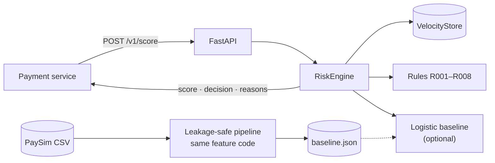

# realtime-fraud-risk-engine

[](https://github.com/Csaf111/realtime-fraud-risk-engine/actions/workflows/ci.yml)
[](https://github.com/Csaf111/realtime-fraud-risk-engine/actions/workflows/cd.yml)


A real-time fraud risk scoring API that **explains every decision**. Send it a
mobile-money transaction and it returns a risk score, an `APPROVE` / `REVIEW` / `BLOCK`
decision, and the reasons behind it.

The scoring has two layers:

1. **Transparent rules** (R001–R008), points-based, readable by an analyst. These work
   from day one with no training data.
2. **An optional model** trained on [PaySim](docs/dataset-paysim.md): a logistic-regression
   baseline (its per-feature contributions are exact, so the explanation *is* the model) or
   gradient-boosted trees with exact TreeSHAP explanations. Both are served in pure Python.

The offline pipeline is built to be **leakage-safe**: it uses the same feature code as the
API, point-in-time velocity features, a time-based split with a gap, and checks that stop
training if anything leaks. See [docs/leakage-safe-preprocessing.md](docs/leakage-safe-preprocessing.md).

> **Status:** starter project / baseline. PaySim is synthetic and has known artefacts, so
> treat offline metrics accordingly (details in the dataset doc).

---

## Contents

- [Quick start](#quick-start)
- [API](#api)
- [How scoring works](#how-scoring-works)
- [Training on PaySim](#training-on-paysim)
- [Architecture](#architecture)
- [Testing](#testing)
- [Docker](#docker)
- [CI/CD and branches](#cicd-and-branches)
- [Configuration](#configuration)
- [Project layout](#project-layout)
- [Roadmap](#roadmap)

---

## Quick start

```bash
git clone https://github.com/Csaf111/realtime-fraud-risk-engine.git
cd realtime-fraud-risk-engine
python -m venv .venv && source .venv/bin/activate
make install          # pip install -e ".[dev]"
make test             # 100+ tests, coverage gate 85%
make run              # http://localhost:8000/docs
```

In another terminal:

```bash
curl -s localhost:8000/v1/score -H 'content-type: application/json' \
  -d @scripts/sample_fraud.json | python -m json.tool
```

Or with Docker: `docker compose up --build`.

## API

Interactive docs live at `/docs` (Swagger) and `/redoc`.

| Method | Path | Purpose |
|---|---|---|
| `POST` | `/v1/score` | Score one transaction |
| `POST` | `/v1/score/batch` | Score up to `FRE_MAX_BATCH_SIZE` transactions **in order** |
| `POST` | `/v1/labels` | Report delayed fraud labels for scored transactions (monitoring only) |
| `GET` | `/v1/rules` | The rulebook (code, description, points) |
| `GET` | `/health` | Liveness |
| `GET` | `/ready` | Readiness + mode (`rules-only` / `rules+model`) + model version |
| `GET` | `/metrics` | Prometheus-format counters, latency histogram, per-rule hits, score histogram |

Every response carries an `x-request-id` header. The API echoes yours or generates one.

### Monitoring metrics

`/metrics` exports, alongside request/decision counts and scoring latency:

| Metric | Type | Use |
|---|---|---|
| `fre_scored_total` | counter | Transactions scored (denominator for hit rates) |
| `fre_rule_hits_total{rule="R00x"}` | counter | Times each rule fired |
| `fre_risk_score` | histogram (0.1 … 1.0) | Distribution of final risk scores |
| `fre_score_psi` | gauge | PSI of the last `FRE_DRIFT_WINDOW` scores vs the training score reference (only with `FRE_SCORE_REFERENCE_PATH`, once `FRE_DRIFT_MIN_SAMPLES` scores are in) |
| `fre_score_drift_window_count` | gauge | Live scores currently in the drift window |
| `fre_feature_psi{feature}` | gauge | PSI of each model input over the last `FRE_DRIFT_WINDOW` transactions vs the training feature reference (only with `FRE_FEATURE_REFERENCE_PATH`, once warm) |
| `fre_feature_drift_window_count` | gauge | Feature vectors currently in the feature drift window |
| `fre_feature_drift_skipped_total` | counter | Feature vectors skipped because a value was non-finite |
| `fre_shadow_scored_total`, `fre_shadow_errors_total` | counter | Shadow model successes / failures (only with `FRE_SHADOW_MODEL_PATH`) |
| `fre_shadow_decisions_total{decision}` | counter | Decisions the shadow model *would* have made |
| `fre_shadow_disagreements_total{primary,shadow}` | counter | Live vs shadow decision mismatches |
| `fre_shadow_abs_score_delta_sum`, `fre_shadow_latency_ms_sum` | counter | Score gap and extra latency, for averages |
| `fre_labels_received_total{status}` | counter | Delayed labels by join result: `matched`, `unknown`, `duplicate` |
| `fre_labelled_outcomes_total{decision,label}` | counter | Served decisions joined to their label (`fraud` / `legit`) |
| `fre_label_precision{level}`, `fre_label_recall{level}` | gauge | Rolling precision / recall over the last `FRE_LABEL_WINDOW` labelled outcomes; `level="alert"` (REVIEW or BLOCK) and `level="block"` |
| `fre_label_pending`, `fre_label_pending_evicted_total`, `fre_label_window_count` | gauge / counter | Decisions awaiting a label, those dropped unlabelled, labelled outcomes in the window |

Per-rule hit rate in PromQL:
`rate(fre_rule_hits_total[1h]) / ignoring(rule) group_left rate(fre_scored_total[1h])`.
A jump in one rule's hit rate, or a shift in the score histogram, is the earliest signal of
upstream data changes or a new attack pattern. Labels carry only rule codes, never account
names or amounts.

Shadow disagreement rate in PromQL:
`sum(rate(fre_shadow_disagreements_total[1h])) / rate(fre_shadow_scored_total[1h])`.
Watch the `primary="APPROVE",shadow="BLOCK"` cell before promoting a candidate model.

### Score drift (PSI)

Training writes `models/baseline.score_reference.json`: the share of served scores in each
histogram bin on the most recent `--validation-frac` of the training window, computed with
`--model-weight` (label-free, never the test window). Serve it alongside the model:

```bash
FRE_MODEL_PATH=models/baseline.json \
FRE_SCORE_REFERENCE_PATH=models/baseline.score_reference.json make run
```

`fre_score_psi` then compares a rolling window of live scores with that reference
(PSI < 0.1 stable, 0.1–0.25 moderate, > 0.25 significant). A Prometheus alert:

```yaml
- alert: FraudScoreDrift
  expr: max(fre_score_psi) > 0.25
  for: 30m
  labels: {severity: warning}
  annotations:
    summary: "Live fraud score distribution has drifted from the training window"
```

The window is per replica. Use the reference built with the same `FRE_MODEL_WEIGHT` you
serve, and retrain the reference whenever the model changes; a bad reference file stops
the API at startup rather than reporting nonsense.

### Feature drift (PSI per input)

Score PSI tells you *that* the distribution moved; feature PSI tells you *which input*
moved. Training also writes `models/baseline.feature_reference.json`: decile cut points
and bin shares for every feature in `FEATURE_NAMES`, from the same train-window tail
(label-free, point-in-time features, never the test window). Binary features collapse to
two or three bins; live values beyond the training range land in the last bin.

```bash
FRE_MODEL_PATH=models/baseline.json \
FRE_SCORE_REFERENCE_PATH=models/baseline.score_reference.json \
FRE_FEATURE_REFERENCE_PATH=models/baseline.feature_reference.json make run
```

`fre_feature_psi{feature="log_amount"}` (one series per model input, fixed label set)
uses the same window and warm-up as score PSI. Investigate the top movers when the score
alert fires:

```yaml
- alert: FraudFeatureDrift
  expr: max by (feature) (fre_feature_psi) > 0.25
  for: 1h
  labels: {severity: info}
  annotations:
    summary: "Model input {{ $labels.feature }} has drifted from the training window"
```

Feature references work in rules-only mode too (the features are computed either way).
A reference whose feature set differs from the serving code stops the API at startup.

### Delayed-label performance monitoring

Drift says the inputs moved; labels say whether the engine still catches fraud. Chargebacks
and analyst verdicts arrive late, so post them back by `transaction_id` whenever they land:

```bash
curl -s localhost:8000/v1/labels -H 'content-type: application/json' \
  -d '{"labels": [{"transaction_id": "demo-fraud-001", "is_fraud": true}]}'
# {"matched": 1, "unknown": 0, "duplicate": 0}
```

Each replica keeps up to `FRE_LABEL_PENDING_CAPACITY` served decisions (score and decision
only, no transaction data) for transactions that carried a `transaction_id`. A label joins
to that decision, and `fre_label_precision` / `fre_label_recall` report rolling performance
over the last `FRE_LABEL_WINDOW` labelled outcomes. What-if batch scores
(`update_state=false`) are not tracked; labels for unknown or evicted ids count as
`unknown`, retries as `duplicate`, and neither is double-counted. Precision and recall are
omitted until defined. A recall alert:

```yaml
- alert: FraudRecallDrop
  expr: min(fre_label_recall{level="alert"}) < 0.5 and min(fre_label_window_count) > 200
  for: 6h
  labels: {severity: warning}
  annotations:
    summary: "Labelled recall of REVIEW+BLOCK has dropped"
```

Labels are used **only** for these metrics: they never reach features, rules, the model or
the velocity store, so posting one cannot change a later score (tested). State is per
replica: send labels to the replica that scored the transaction, or sum
`fre_labelled_outcomes_total` across replicas in Prometheus to compute cluster-wide rates.

### Request

Field names match the PaySim columns, so a dataset row can be posted as-is once you remove
the labels. Sending `isFraud` or `isFlaggedFraud` returns **422**.

```json
{
  "transaction_id": "demo-fraud-001",
  "step": 1,
  "type": "TRANSFER",
  "amount": 250000.0,
  "nameOrig": "C1305486145",
  "oldbalanceOrg": 250000.0,
  "newbalanceOrig": 0.0,
  "nameDest": "C553264065",
  "oldbalanceDest": 0.0,
  "newbalanceDest": 0.0
}
```

### Response

```json
{
  "transaction_id": "demo-fraud-001",
  "risk_score": 0.8,
  "decision": "BLOCK",
  "rules_score": 0.8,
  "model_score": null,
  "reasons": [
    "R002: Origin account emptied by this transaction",
    "R005: Destination balance unchanged after inbound funds",
    "R001: High-risk transaction type (TRANSFER / CASH_OUT)",
    "R003: Amount at or above high-value threshold"
  ],
  "rule_hits": [{"code": "R002", "description": "Origin account emptied by this transaction", "points": 30.0}, "..."],
  "top_features": [],
  "model_version": "rules-v0.1.0",
  "latency_ms": 0.12
}
```

With a model loaded, `model_score` is filled in and `top_features` lists the features that
pushed risk up, each with its exact log-odds contribution.

## How scoring works

```
features   = compute_features(txn, velocity_snapshot_before_txn)
rules      = Σ points of fired rules, capped at 100  → rules_score ∈ [0, 1]
model      = σ(intercept + Σ coef_i · (x_i − μ_i) / σ_i)      (optional, logistic)
           | σ(base + Σ_trees tree(x))                         (optional, --model gbt)
risk_score = w · model + (1 − w) · rules                      (w = FRE_MODEL_WEIGHT)
decision   = BLOCK if ≥ block_threshold, REVIEW if ≥ review_threshold, else APPROVE
```

### Rules

| Code | Fires when | Points |
|---|---|---|
| R001 | Type is `TRANSFER` or `CASH_OUT` (the only fraud types in PaySim) | 15 |
| R002 | Origin is emptied (≥95% of balance, new balance 0) by TRANSFER/CASH_OUT | 30 |
| R003 | Amount ≥ `FRE_HIGH_AMOUNT_THRESHOLD` (default 200,000) | 15 |
| R004 | Origin balances don't reconcile with the amount | 10 |
| R005 | Customer destination balance unchanged after inbound funds | 20 |
| R006 | Amount exceeds the origin's available balance | 10 |
| R007 | Destination received ≥5 payments in the velocity window (mule signal) | 15 |
| R008 | Origin sent ≥3 payments in the velocity window | 10 |

### Features (17)

`log_amount`, one-hot `type_*` (CASH_IN baseline), signed-log `orig_balance_error` and
`dest_balance_error`, `orig_drained`, `amount_to_orig_balance` (capped), `dest_is_merchant`,
`dest_zero_balances`, cyclic `hour_sin` / `hour_cos`, and velocity features
(`orig_txn_count_window`, `log_orig_amount_window`, `dest_inbound_count_window`,
`log_dest_inbound_window`).

Velocity is computed from a `VelocityStore` that is read **before** the current event and
updated **after** it, so a transaction never sees itself or the future.

### Shared velocity state (multi-replica)

By default the store is in-process, so each replica only sees its own traffic. Set
`FRE_VELOCITY_BACKEND=redis` to keep velocity in Redis sorted sets keyed by account
(`<prefix>:orig:<nameOrig>` / `<prefix>:dest:<nameDest>`, score = step), shared by every
replica:

```bash
pip install -e ".[redis]"          # redis-py is optional; the default image stays slim
FRE_VELOCITY_BACKEND=redis FRE_REDIS_URL=redis://localhost:6379/0 make run
```

`RedisVelocityStore` implements the same `VelocityBackend` interface and window semantics
as the in-memory store; a parity test replays a random step-ordered stream through both
and requires identical snapshots. `snapshot` and `record` are separate round trips, so
two replicas scoring the *same account* concurrently can miss each other's in-flight
event; partition traffic by account if you need a strict order.

## Training on PaySim

1. Get the data (details and licence in [docs/dataset-paysim.md](docs/dataset-paysim.md)):
   ```bash
   kaggle datasets download -d ealaxi/paysim1 -p data/raw --unzip
   mv data/raw/PS_*.csv data/raw/paysim.csv
   ```
2. Train:
   ```bash
   make train
   # or a quicker run on the first 500k rows:
   python -m fraud_engine.train --data data/raw/paysim.csv --nrows 500000
   ```
3. Serve it:
   ```bash
   FRE_MODEL_PATH=models/baseline.json make run
   ```

`train.py` always prints **model vs rules-only** metrics (ROC-AUC, PR-AUC, precision,
recall) on a future, gapped test window. It also writes `models/baseline.metrics.json`
with the split boundaries and the leakage report.

### Thresholds from an alert budget

Ops teams size queues in capacity, not probabilities. Pass the share of traffic you can
afford to review and to block, and training recommends matching thresholds:

```bash
python -m fraud_engine.train --data data/raw/paysim.csv \
    --review-budget 0.01 --block-budget 0.002   # review ≤ 1%, block ≤ 0.2%
# ...
# Recommended: FRE_REVIEW_THRESHOLD=0.41 FRE_BLOCK_THRESHOLD=0.87 FRE_MODEL_WEIGHT=0.6
```

Thresholds are picked on the most recent `--validation-frac` (default 20%) of the
training window using only the served score distribution (no labels), then evaluated on
the held-out test window: `alert_budget.test` in the metrics JSON reports the realised
alert rate, precision and recall at each level. Scores are computed with the same
`blend_risk` the API uses, so set `--model-weight` to your `FRE_MODEL_WEIGHT`.

### Gradient-boosted trees (TreeSHAP)

```bash
python -m fraud_engine.train --data data/raw/paysim.csv --model gbt \
    --n-estimators 100 --max-depth 3 --learning-rate 0.1 --out models/gbt.json
FRE_MODEL_PATH=models/gbt.json make run
```

`--model gbt` fits scikit-learn's `GradientBoostingClassifier` (class-balanced sample
weights) on **exactly the same point-in-time features, split and leakage checks** as the
baseline, then exports every tree to a JSON artifact (`model_type:
"gradient_boosted_trees"`). Training fails if the pure-Python export disagrees with
scikit-learn's log-odds on the test window. The API needs no new dependencies:

- `FRE_MODEL_PATH` / `FRE_SHADOW_MODEL_PATH` load either artifact type automatically, so a
  GBT candidate can be **shadowed** against a live logistic model before promotion.
- `top_features` are exact path-dependent **TreeSHAP** values in log-odds. They are
  additive: `Σ contributions = log_odds(x) − expected_log_odds`, where the expectation is
  the cover-weighted training average.
- `model_version` reads `rules-v…+gbt-<version>` (logistic: `+lr-<version>`).
- Cost is O(trees × leaves × depth²) per request: about 4 ms for 100 depth-3 trees on a
  laptop, so keep ensembles small or raise latency budgets accordingly.

Artifacts are validated on load (finite values, child indices that can only point
forward, child covers summing to the parent's, depth ≤ 32) — see
[docs/model-artifact-integrity.md](docs/model-artifact-integrity.md).

To try the pipeline without the real dataset: `make train-synthetic` (the metrics are
meaningless, it only proves the plumbing works).

## Streaming mode (Kafka skeleton)

Score an ordered stream instead of HTTP calls, with the same schema checks and engine:

```bash
python -m fraud_engine.stream --input txns.jsonl --output results.jsonl --dead-letter dlq.jsonl
```

Bad messages (invalid JSON, label columns, oversized) go to a dead-letter sink instead of
stopping the consumer, late events can be rejected with `--allowed-lateness`, and a Kafka
loop (`--kafka-topic`, optional `confluent-kafka` client) commits offsets only after each
result is written. Details and ordering caveats: [docs/streaming.md](docs/streaming.md).

## Architecture

Full diagrams (system context, request sequence, training pipeline, scoring, CI/CD) are in
[docs/architecture.md](docs/architecture.md).



## Testing

```bash
make test        # everything + coverage (gate: 85%)
make test-fast   # skip the slow end-to-end training tests
make lint typecheck
```

| File | Covers |
|---|---|
| `test_features.py` | Every feature, ordering contract, edge cases |
| `test_state.py` | Window maths, no self/future visibility, caps |
| `test_state_redis.py` | Redis backend (fakeredis): same window semantics, parity with in-memory, shared state across replicas, namespacing |
| `test_rules.py` | Each rule, capping, ordering, configurable thresholds |
| `test_model.py` | Contributions sum to the logit, persistence, schema guards |
| `test_trees.py` | Gradient-boosted trees: TreeSHAP equals brute-force Shapley values, additivity, scikit-learn export parity, artifact validation, loader dispatch, serving + shadowing |
| `test_scoring.py` | Rules-only vs blended, decisions, stateful velocity, settings |
| `test_preprocessing.py` | **Leakage tests**: label independence, future invariance, online/offline parity, split gap, forbidden columns |
| `test_train.py` | End-to-end training (logistic and `--model gbt`) on synthetic data, CLI, export parity gate |
| `test_api.py` | All endpoints, validation, label rejection, batch limits, metrics |
| `test_metrics.py` | Rule-hit counters, cumulative score histogram, no identifiers in labels |
| `test_thresholds.py` | Alert-budget threshold selection: ties, saturation, ordering, test-window evaluation |
| `test_drift.py` | PSI maths, score reference round-trip and validation, rolling window, `/metrics` export, label-independent reference from the training window |
| `test_outcomes.py` | Delayed-label join: matched/unknown/duplicate, bounded buffers, rolling precision/recall, `/v1/labels`, labels never change later scores |
| `test_feature_drift.py` | Quantile binning, feature reference round-trip and `FEATURE_NAMES` guard, monitor pinpoints the moved input, engine observer hook, `/metrics` export, label-independent reference from the training window |

## Docker

```bash
make docker-build && make docker-run       # rules-only
docker compose up --build                  # same, via compose
```

The image is multi-stage and runs as a non-root user. It contains only the serving
dependencies (FastAPI, Uvicorn, Pydantic; no pandas or scikit-learn) and has a built-in
`HEALTHCHECK`. To serve a model, mount `models/` and set
`FRE_MODEL_PATH=/app/models/baseline.json`.

## CI/CD and branches

```
feature/*  ──PR──▶  v1  ──promote──▶  staging  ──promote──▶  prod
                    │                  │                      │
                    CI                 CD → GHCR :staging     CD → GHCR :prod :latest :vX
                                       → deploy staging       → approval → deploy production → release
```

- **CI** (`ci.yml`): ruff, mypy, pytest on 3.11–3.13 with coverage gate, dependency audit,
  synthetic training run, Docker build plus container smoke tests (rules-only and with a model).
- **CD** (`cd.yml`): reuses CI as a gate, pushes to GitHub Container Registry, deploys to
  the matching GitHub environment, runs a post-deploy smoke test, and creates a release on prod.
- **Promote** (`promote.yml`): manual button that opens `v1 → staging` or `staging → prod` PRs.

The one-time GitHub settings (environments, approvals, branch protection, deploy webhook)
are in [docs/cicd.md](docs/cicd.md).

## Configuration

| Variable | Default | Meaning |
|---|---|---|
| `FRE_REVIEW_THRESHOLD` | `0.5` | Score at/above which → `REVIEW` |
| `FRE_BLOCK_THRESHOLD` | `0.8` | Score at/above which → `BLOCK` |
| `FRE_MODEL_PATH` | unset | Path to a model artifact (logistic or gradient-boosted trees). Unset means rules-only |
| `FRE_MODEL_WEIGHT` | `0.6` | Blend weight of the model vs rules |
| `FRE_VELOCITY_WINDOW_STEPS` | `24` | Velocity look-back (PaySim steps = hours) |
| `FRE_HIGH_AMOUNT_THRESHOLD` | `200000` | R003 threshold |
| `FRE_MAX_BATCH_SIZE` | `1000` | Batch endpoint limit |
| `FRE_ENVIRONMENT` | `local` | Reported by `/ready` |
| `FRE_VELOCITY_BACKEND` | `memory` | `memory` (per process) or `redis` (shared across replicas; needs the `redis` extra) |
| `FRE_REDIS_URL` | `redis://localhost:6379/0` | Redis connection URL for the `redis` backend |
| `FRE_REDIS_KEY_PREFIX` | `fre:velocity` | Namespace for velocity keys in Redis |
| `FRE_SCORE_REFERENCE_PATH` | unset | Training score reference; enables `fre_score_psi` |
| `FRE_FEATURE_REFERENCE_PATH` | unset | Training per-feature reference; enables `fre_feature_psi` |
| `FRE_DRIFT_WINDOW` | `5000` | Live scores / feature vectors in the rolling PSI windows |
| `FRE_DRIFT_MIN_SAMPLES` | `500` | Observations needed before PSI is reported |
| `FRE_SHADOW_MODEL_PATH` | unset | Candidate model scored in shadow mode: same features, never affects the response; compared via `fre_shadow_*` metrics |
| `FRE_LABEL_PENDING_CAPACITY` | `100000` | Served decisions kept awaiting a delayed label (`0` disables `/v1/labels`) |
| `FRE_LABEL_WINDOW` | `5000` | Labelled outcomes in the rolling precision/recall window |
| `PORT` | `8000` | Container listen port |

## Project layout

```
.
├── src/fraud_engine/
│   ├── api.py             FastAPI app (create_app factory)
│   ├── scoring.py         RiskEngine: features → rules → model → decision
│   ├── features.py        Shared online/offline feature code
│   ├── state.py           Point-in-time VelocityStore + backend factory
│   ├── state_redis.py     Redis-backed VelocityStore (optional extra)
│   ├── rules.py           Rulebook R001–R008
│   ├── model.py           Pure-Python logistic baseline + exact explanations
│   ├── trees.py           Pure-Python gradient-boosted trees + exact TreeSHAP
│   ├── artifacts.py       Model artifact loader (dispatch on model_type)
│   ├── preprocessing.py   Leakage-safe PaySim pipeline + checks
│   ├── train.py           Training CLI
│   ├── synthetic.py       PaySim-shaped generator for CI
│   ├── schemas.py         Pydantic request/response models
│   ├── metrics.py         Prometheus-format metrics
│   ├── drift.py           Score reference + rolling PSI drift monitor
│   ├── feature_drift.py   Per-feature quantile reference + rolling feature PSI
│   ├── outcomes.py        Delayed-label join + rolling precision/recall
│   └── config.py          FRE_* settings
├── tests/                 Unit, leakage and API tests
├── docs/                  Dataset, leakage plan, architecture, CI/CD
├── scripts/               Smoke test + sample payloads
├── .github/workflows/     ci.yml, cd.yml, promote.yml
├── Dockerfile, docker-compose.yml, Makefile, pyproject.toml
└── data/, models/         Git-ignored (dataset + artifacts)
```

## Roadmap

- [x] Redis-backed `VelocityStore` for multi-replica deployments (`FRE_VELOCITY_BACKEND=redis`)
- [x] Gradient-boosted model with exact TreeSHAP explanations (`--model gbt`, pure-Python serving)
- [ ] Rules as a hard score floor for the model blend
- [x] Threshold selection from an alert budget on a validation window (`--review-budget` / `--block-budget`)
- [ ] Kafka consumer mode for streaming ingestion
- [x] Monitoring metrics: per-rule hit counts and risk-score histogram on `/metrics`
- [x] Drift detection: PSI of live score distribution vs the training window (`fre_score_psi`, example alert rule)
- [x] Feature-level drift: PSI per input feature (`FRE_FEATURE_REFERENCE_PATH`, `fre_feature_psi{feature}`)
- [x] Label-delayed performance monitoring (`POST /v1/labels`, `fre_label_precision` / `fre_label_recall`)
- [x] Shadow model deployments (`FRE_SHADOW_MODEL_PATH`, `fre_shadow_*` agreement metrics)
- [ ] Delayed-label feedback loop

## Acknowledgements

PaySim: E. A. Lopez-Rojas, A. Elmir, S. Axelsson, *PaySim: A financial mobile money
simulator for fraud detection*, EMSS 2016. Dataset on Kaggle under CC BY-SA 4.0.

## Licence

MIT. See [LICENSE](LICENSE).
