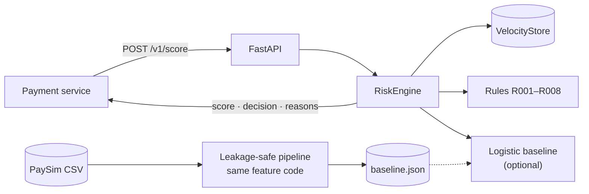

# realtime-fraud-risk-engine

[](https://github.com/Csaf111/realtime-fraud-risk-engine/actions/workflows/ci.yml)
[](https://github.com/Csaf111/realtime-fraud-risk-engine/actions/workflows/cd.yml)


A real-time fraud risk scoring API that **explains every decision**. Send it a
mobile-money transaction and it returns a risk score, an `APPROVE` / `REVIEW` / `BLOCK`
decision, and the reasons behind it.

The scoring has two layers:

1. **Transparent rules** (R001–R008), points-based, readable by an analyst. These work
   from day one with no training data.
2. **An optional logistic-regression baseline** trained on [PaySim](docs/dataset-paysim.md).
   Its per-feature contributions are exact, so the explanation *is* the model.

The offline pipeline is built to be **leakage-safe**: it uses the same feature code as the
API, point-in-time velocity features, a time-based split with a gap, and checks that stop
training if anything leaks. See [docs/leakage-safe-preprocessing.md](docs/leakage-safe-preprocessing.md).

> **Status:** starter project / baseline. PaySim is synthetic and has known artefacts, so
> treat offline metrics accordingly (details in the dataset doc).

---

## Contents

- [Quick start](#quick-start)
- [API](#api)
- [How scoring works](#how-scoring-works)
- [Training on PaySim](#training-on-paysim)
- [Architecture](#architecture)
- [Testing](#testing)
- [Docker](#docker)
- [CI/CD and branches](#cicd-and-branches)
- [Configuration](#configuration)
- [Project layout](#project-layout)
- [Roadmap](#roadmap)

---

## Quick start

```bash
git clone https://github.com/Csaf111/realtime-fraud-risk-engine.git
cd realtime-fraud-risk-engine
python -m venv .venv && source .venv/bin/activate
make install          # pip install -e ".[dev]"
make test             # 80+ tests, coverage gate 85%
make run              # http://localhost:8000/docs
```

In another terminal:

```bash
curl -s localhost:8000/v1/score -H 'content-type: application/json' \
  -d @scripts/sample_fraud.json | python -m json.tool
```

Or with Docker: `docker compose up --build`.

## API

Interactive docs live at `/docs` (Swagger) and `/redoc`.

| Method | Path | Purpose |
|---|---|---|
| `POST` | `/v1/score` | Score one transaction |
| `POST` | `/v1/score/batch` | Score up to `FRE_MAX_BATCH_SIZE` transactions **in order** |
| `GET` | `/v1/rules` | The rulebook (code, description, points) |
| `GET` | `/health` | Liveness |
| `GET` | `/ready` | Readiness + mode (`rules-only` / `rules+model`) + model version |
| `GET` | `/metrics` | Prometheus-format counters and latency histogram |

Every response carries an `x-request-id` header. The API echoes yours or generates one.

### Request

Field names match the PaySim columns, so a dataset row can be posted as-is once you remove
the labels. Sending `isFraud` or `isFlaggedFraud` returns **422**.

```json
{
  "transaction_id": "demo-fraud-001",
  "step": 1,
  "type": "TRANSFER",
  "amount": 250000.0,
  "nameOrig": "C1305486145",
  "oldbalanceOrg": 250000.0,
  "newbalanceOrig": 0.0,
  "nameDest": "C553264065",
  "oldbalanceDest": 0.0,
  "newbalanceDest": 0.0
}
```

### Response

```json
{
  "transaction_id": "demo-fraud-001",
  "risk_score": 0.8,
  "decision": "BLOCK",
  "rules_score": 0.8,
  "model_score": null,
  "reasons": [
    "R002: Origin account emptied by this transaction",
    "R005: Destination balance unchanged after inbound funds",
    "R001: High-risk transaction type (TRANSFER / CASH_OUT)",
    "R003: Amount at or above high-value threshold"
  ],
  "rule_hits": [{"code": "R002", "description": "Origin account emptied by this transaction", "points": 30.0}, "..."],
  "top_features": [],
  "model_version": "rules-v0.1.0",
  "latency_ms": 0.12
}
```

With a model loaded, `model_score` is filled in and `top_features` lists the features that
pushed risk up, each with its exact log-odds contribution.

## How scoring works

```
features   = compute_features(txn, velocity_snapshot_before_txn)
rules      = Σ points of fired rules, capped at 100  → rules_score ∈ [0, 1]
model      = σ(intercept + Σ coef_i · (x_i − μ_i) / σ_i)      (optional)
risk_score = w · model + (1 − w) · rules                      (w = FRE_MODEL_WEIGHT)
decision   = BLOCK if ≥ block_threshold, REVIEW if ≥ review_threshold, else APPROVE
```

### Rules

| Code | Fires when | Points |
|---|---|---|
| R001 | Type is `TRANSFER` or `CASH_OUT` (the only fraud types in PaySim) | 15 |
| R002 | Origin is emptied (≥95% of balance, new balance 0) by TRANSFER/CASH_OUT | 30 |
| R003 | Amount ≥ `FRE_HIGH_AMOUNT_THRESHOLD` (default 200,000) | 15 |
| R004 | Origin balances don't reconcile with the amount | 10 |
| R005 | Customer destination balance unchanged after inbound funds | 20 |
| R006 | Amount exceeds the origin's available balance | 10 |
| R007 | Destination received ≥5 payments in the velocity window (mule signal) | 15 |
| R008 | Origin sent ≥3 payments in the velocity window | 10 |

### Features (17)

`log_amount`, one-hot `type_*` (CASH_IN baseline), signed-log `orig_balance_error` and
`dest_balance_error`, `orig_drained`, `amount_to_orig_balance` (capped), `dest_is_merchant`,
`dest_zero_balances`, cyclic `hour_sin` / `hour_cos`, and velocity features
(`orig_txn_count_window`, `log_orig_amount_window`, `dest_inbound_count_window`,
`log_dest_inbound_window`).

Velocity is computed from a `VelocityStore` that is read **before** the current event and
updated **after** it, so a transaction never sees itself or the future.

## Training on PaySim

1. Get the data (details and licence in [docs/dataset-paysim.md](docs/dataset-paysim.md)):
   ```bash
   kaggle datasets download -d ealaxi/paysim1 -p data/raw --unzip
   mv data/raw/PS_*.csv data/raw/paysim.csv
   ```
2. Train:
   ```bash
   make train
   # or a quicker run on the first 500k rows:
   python -m fraud_engine.train --data data/raw/paysim.csv --nrows 500000
   ```
3. Serve it:
   ```bash
   FRE_MODEL_PATH=models/baseline.json make run
   ```

`train.py` always prints **model vs rules-only** metrics (ROC-AUC, PR-AUC, precision,
recall) on a future, gapped test window. It also writes `models/baseline.metrics.json`
with the split boundaries and the leakage report.

To try the pipeline without the real dataset: `make train-synthetic` (the metrics are
meaningless, it only proves the plumbing works).

## Architecture

Full diagrams (system context, request sequence, training pipeline, scoring, CI/CD) are in
[docs/architecture.md](docs/architecture.md).



## Testing

```bash
make test        # everything + coverage (gate: 85%)
make test-fast   # skip the slow end-to-end training tests
make lint typecheck
```

| File | Covers |
|---|---|
| `test_features.py` | Every feature, ordering contract, edge cases |
| `test_state.py` | Window maths, no self/future visibility, caps |
| `test_rules.py` | Each rule, capping, ordering, configurable thresholds |
| `test_model.py` | Contributions sum to the logit, persistence, schema guards |
| `test_scoring.py` | Rules-only vs blended, decisions, stateful velocity, settings |
| `test_preprocessing.py` | **Leakage tests**: label independence, future invariance, online/offline parity, split gap, forbidden columns |
| `test_train.py` | End-to-end training on synthetic data, CLI |
| `test_api.py` | All endpoints, validation, label rejection, batch limits, metrics |

## Docker

```bash
make docker-build && make docker-run       # rules-only
docker compose up --build                  # same, via compose
```

The image is multi-stage and runs as a non-root user. It contains only the serving
dependencies (FastAPI, Uvicorn, Pydantic; no pandas or scikit-learn) and has a built-in
`HEALTHCHECK`. To serve a model, mount `models/` and set
`FRE_MODEL_PATH=/app/models/baseline.json`.

## CI/CD and branches

```
feature/*  ──PR──▶  v1  ──promote──▶  staging  ──promote──▶  prod
                    │                  │                      │
                    CI                 CD → GHCR :staging     CD → GHCR :prod :latest :vX
                                       → deploy staging       → approval → deploy production → release
```

- **CI** (`ci.yml`): ruff, mypy, pytest on 3.11–3.13 with coverage gate, dependency audit,
  synthetic training run, Docker build plus container smoke tests (rules-only and with a model).
- **CD** (`cd.yml`): reuses CI as a gate, pushes to GitHub Container Registry, deploys to
  the matching GitHub environment, runs a post-deploy smoke test, and creates a release on prod.
- **Promote** (`promote.yml`): manual button that opens `v1 → staging` or `staging → prod` PRs.

The one-time GitHub settings (environments, approvals, branch protection, deploy webhook)
are in [docs/cicd.md](docs/cicd.md).

## Configuration

| Variable | Default | Meaning |
|---|---|---|
| `FRE_REVIEW_THRESHOLD` | `0.5` | Score at/above which → `REVIEW` |
| `FRE_BLOCK_THRESHOLD` | `0.8` | Score at/above which → `BLOCK` |
| `FRE_MODEL_PATH` | unset | Path to `baseline.json`. Unset means rules-only |
| `FRE_MODEL_WEIGHT` | `0.6` | Blend weight of the model vs rules |
| `FRE_VELOCITY_WINDOW_STEPS` | `24` | Velocity look-back (PaySim steps = hours) |
| `FRE_HIGH_AMOUNT_THRESHOLD` | `200000` | R003 threshold |
| `FRE_MAX_BATCH_SIZE` | `1000` | Batch endpoint limit |
| `FRE_ENVIRONMENT` | `local` | Reported by `/ready` |
| `PORT` | `8000` | Container listen port |

## Project layout

```
.
├── src/fraud_engine/
│   ├── api.py             FastAPI app (create_app factory)
│   ├── scoring.py         RiskEngine: features → rules → model → decision
│   ├── features.py        Shared online/offline feature code
│   ├── state.py           Point-in-time VelocityStore
│   ├── rules.py           Rulebook R001–R008
│   ├── model.py           Pure-Python logistic baseline + exact explanations
│   ├── preprocessing.py   Leakage-safe PaySim pipeline + checks
│   ├── train.py           Training CLI
│   ├── synthetic.py       PaySim-shaped generator for CI
│   ├── schemas.py         Pydantic request/response models
│   ├── metrics.py         Prometheus-format metrics
│   └── config.py          FRE_* settings
├── tests/                 Unit, leakage and API tests
├── docs/                  Dataset, leakage plan, architecture, CI/CD
├── scripts/               Smoke test + sample payloads
├── .github/workflows/     ci.yml, cd.yml, promote.yml
├── Dockerfile, docker-compose.yml, Makefile, pyproject.toml
└── data/, models/         Git-ignored (dataset + artifacts)
```

## Roadmap

- [ ] Redis-backed `VelocityStore` for multi-replica deployments
- [ ] Gradient-boosted model with SHAP explanations, keeping the rules as a floor
- [ ] Threshold selection from an alert budget on a validation window
- [ ] Kafka consumer mode for streaming ingestion
- [ ] Drift monitoring (score distribution, per-rule hit rates)
- [ ] Delayed-label feedback loop and shadow deployments

## Acknowledgements

PaySim: E. A. Lopez-Rojas, A. Elmir, S. Axelsson, *PaySim: A financial mobile money
simulator for fraud detection*, EMSS 2016. Dataset on Kaggle under CC BY-SA 4.0.

## Licence

MIT. See [LICENSE](LICENSE).
