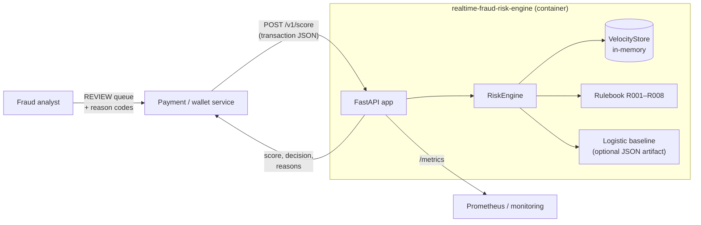
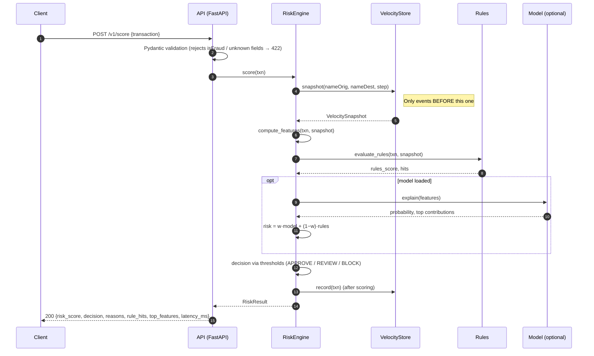
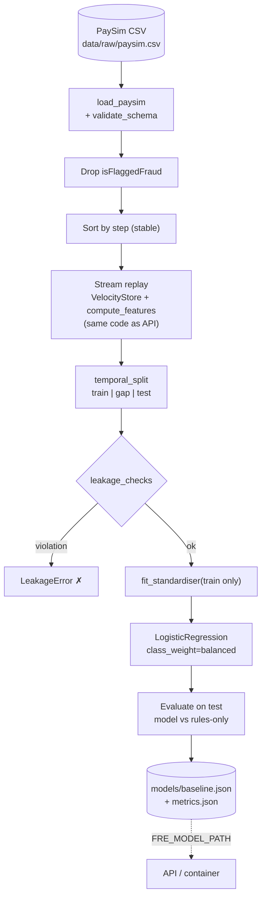
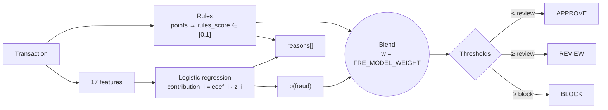
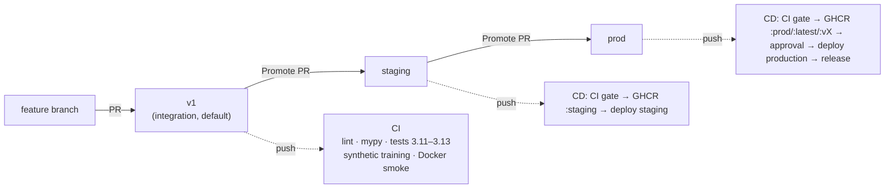

# Architecture

## 1. System context

## 2. Request flow

## 3. Offline training pipeline (leakage-safe)

## 4. Scoring and explainability

The model is linear in standardised features. Each feature's log-odds contribution is exact,
not a SHAP-style approximation. Rule hits carry stable codes that analysts can look up via
`GET /v1/rules`.

## 5. CI/CD and branch promotion

## 6. Scaling notes

| Concern | Today (starter) | Next step |
|---|---|---|
| Velocity state | In-process dict of deques, one worker per container | Redis sorted sets keyed by account (`ZADD`/`ZRANGEBYSCORE`), same interface |
| Model | JSON coefficients, pure-Python inference (~µs) | Gradient-boosted trees + SHAP. Keep the rules as a floor |
| Throughput | Single uvicorn worker | Horizontal replicas behind a load balancer, once state is shared |
| Ingestion | Synchronous HTTP | Kafka consumer that scores events and emits decisions |
| Feedback | None | Label ingestion (chargebacks) → delayed-label retraining → shadow deployment |
| Monitoring | Counters + latency histogram | Score-distribution drift, alert rate, per-rule hit rate |
