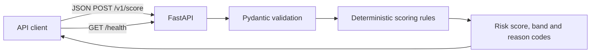
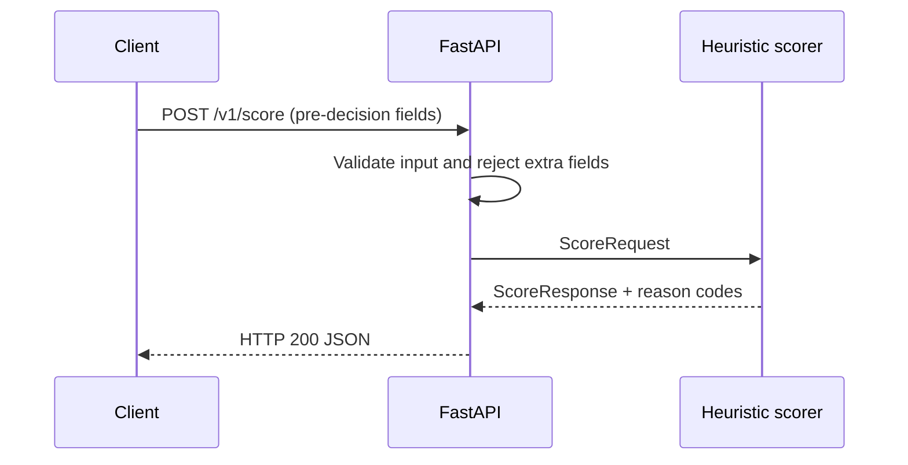
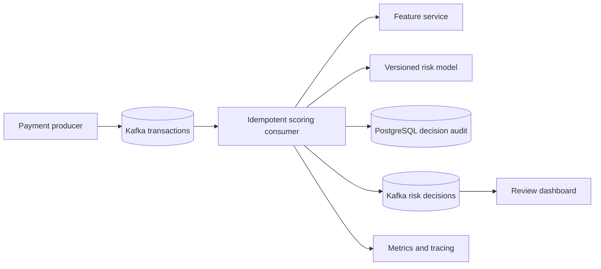

# Architecture

## Current state: synchronous explainable baseline

The service is stateless and does not call external databases or model endpoints. All scoring logic lives in `app/scoring.py`; request and response contracts are in `app/schemas.py`. This separation permits rule testing without HTTP and keeps the API adapter thin.

## Trust and data boundaries

- `transaction_id` is a caller-provided correlation identifier, not an idempotency guarantee.
- The API does not persist or log transaction bodies by default. Access logs from a reverse proxy or hosting platform may still need redaction.
- `origin_balance` is optional. If absent, the scorer does not assume a zero balance.
- Post-event balances, `isFraud` and `isFlaggedFraud` are not accepted in the API schema.
- Risk score is a transparent rules score, **not** a statistical probability.

## Future event-driven design (not implemented)

Planned delivery semantics: at-least-once input, deduplication by stable event ID, explicit schema versions, bounded retries, dead-letter handling, and an auditable decision record. The initial synchronous API does **not** implement these guarantees.

## Engineering decisions

| Decision | Rationale | Trade-off |
| --- | --- | --- |
| FastAPI + Pydantic | Typed OpenAPI contracts and validation | Requires Python runtime |
| Deterministic rules | Easy to audit and test | Cannot learn fraud patterns |
| Stateless API | Simple local operation | No decision history, deduplication or monitoring |
| Optional origin balance | Explicit missingness | May under-score transactions with unavailable balance |
| No database | Minimal setup and attack surface | No persistent audit trail |
| CI test matrix | Catches Python-version regressions | No deployment or load test yet |

## Operational next steps

Add authenticated ingress, structured redacted logging, request IDs, metrics, latency/load benchmarks, dependency pinning, image scanning, and a staging environment before calling this production-ready.
