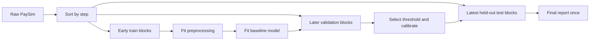

# Leakage-safe ML preprocessing and evaluation plan

**Status: design only.** No training pipeline or learned model is currently implemented.

## Prediction contract

Predict whether a transaction may be fraudulent **at authorization time**, using only features known before execution. The training label is `isFraud`; it must never enter feature engineering or scoring inputs. Exclude `newbalanceOrig`, `newbalanceDest`, and `isFlaggedFraud` entirely from candidate features.

Candidate features: transaction type, log1p(amount), pre-transaction origin balance if known, amount/origin-balance ratio with a separate missing/zero-balance indicator, and time-derived features only if that time is known at inference. Do not use raw account IDs as categorical predictors; if historical aggregates are later introduced, construct them from **past events only** with point-in-time joins.

## Temporal splitting

1. Sort by `step` ascending. Do not random-shuffle before splitting.
2. Allocate complete, non-overlapping step blocks: earliest 70% of distinct steps for training, next 15% for validation, latest 15% for final test. Exact split boundaries and sample counts must be recorded.
3. Use validation for feature selection, threshold selection and calibration. Freeze the pipeline before a **single final test evaluation**.
4. Fit imputers, encoders, scaling and any class balancing **only on training**. Apply frozen transformations to validation and test.
5. If cross-validation is needed, use expanding-window folds with a documented temporal gap when feature windows require it.
6. For account-level historical features, ensure aggregation windows end strictly before each event and never include future activity. Evaluate whether repeated account IDs across periods create optimistic results.

## Modelling baseline

Start with logistic regression (class-weighted) and a gradient-boosted tree as a comparative baseline, plus the existing heuristic rules. Use reproducible seeds and record dependency versions. Keep the heuristic score distinct from any learned calibrated probability.

## Evaluation under class imbalance

Report positive class prevalence, confusion matrices at explicitly selected thresholds, precision, recall, F1, PR-AUC (average precision), ROC-AUC as a secondary metric, and precision/recall at a fixed manual-review budget (e.g. top N transactions per 10,000). Include calibration curves and Brier score if probabilities are exposed. Bootstrap confidence intervals by time block or another defensible unit, not naive IID rows when temporal dependence matters.

Always report false positives per 1,000 legitimate transactions and discuss the cost of false declines. Do not select a decision threshold using the final test set.

## Reproducibility acceptance criteria

- A documented CLI ingestion pipeline with schema validation and source checksum.
- Immutable split manifests containing step boundaries, counts and fraud prevalence.
- Unit tests for time ordering, target leakage exclusion, missing-value handling and train-only fitting.
- A versioned model artifact with dataset checksum, feature list, parameters and measured metrics.
- A benchmark against the deterministic rules under the **same** held-out test period.
- No dataset or real credentials committed to Git.

## Failure modes to guard against

Random splitting, post-transaction balance features, using `isFlaggedFraud` as an input, target encoding fit on all rows, oversampling before splitting, future-window aggregates, threshold tuning on the test set, and interpreting synthetic-data scores as real-world performance.
