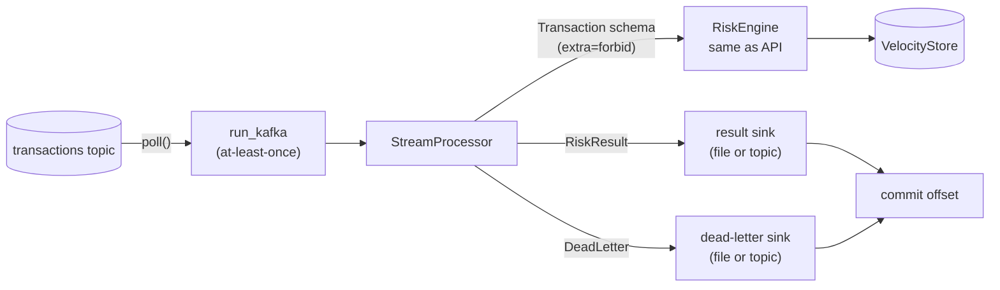

# Streaming consumer mode

`fraud_engine.stream` scores transactions from a log (Kafka today, any ordered source in
principle) instead of HTTP requests. It is a **skeleton**: the processing core,
dead-lettering, ordering policy, an at-least-once Kafka loop and Kafka output/dead-letter
topics, Prometheus metrics export and consumer-group rebalance hooks are implemented and
tested (see "Not done yet" for what remains).



## Usage

```bash
# Replay a JSON-lines file (one PaySim-shaped transaction per line, labels removed)
python -m fraud_engine.stream --input txns.jsonl --output results.jsonl --dead-letter dlq.jsonl

# stdin -> stdout
cat txns.jsonl | python -m fraud_engine.stream --input -

# Kafka (optional client, not in the serving image): pip install confluent-kafka
python -m fraud_engine.stream --kafka-topic transactions --kafka-bootstrap broker:9092 \
    --kafka-group fraud-engine --output results.jsonl

# Kafka in, Kafka out
python -m fraud_engine.stream --kafka-topic transactions --kafka-bootstrap broker:9092 \
    --output-topic risk-results --dead-letter-topic risk-dead-letters
```

Engine settings come from the usual `FRE_*` variables (`FRE_MODEL_PATH`, thresholds, velocity
window). A summary (`received`, `scored`, `dead_lettered`, `late`, decision counts) is printed
to stderr at the end.

| Flag | Meaning |
|---|---|
| `--allowed-lateness STEPS` | Dead-letter events more than `STEPS` behind the highest step seen. Unset = score them, just count them as late |
| `--no-update-state` | Score without recording into velocity state (what-if replays) |
| `--output-topic TOPIC` | Produce results to a Kafka topic instead of `--output` (works with any input) |
| `--dead-letter-topic TOPIC` | Produce dead letters to a Kafka topic instead of `--dead-letter` |
| `--delivery-timeout SECONDS` | How long to wait for the broker to acknowledge each record (default 10) |
| `--metrics-file PATH` | Write `fre_stream_*` Prometheus metrics to `PATH` (textfile-collector format) |
| `--metrics-every N` | Rewrite `--metrics-file` every `N` messages (default 1000); always written at exit, even on failure |

## Metrics

The consumer has no HTTP port, so its counters are exported as a Prometheus **textfile**:
point `--metrics-file` at the node-exporter textfile-collector directory (e.g.
`/var/lib/node_exporter/textfile/fre_stream.prom`), or read it from a sidecar. The file is
written to a temp file and renamed, so a scrape never sees a partial write.

```bash
python -m fraud_engine.stream --kafka-topic transactions --output-topic risk-results \
    --metrics-file /var/lib/node_exporter/textfile/fre_stream.prom --metrics-every 500
```

| Series | Type | Meaning |
|---|---|---|
| `fre_stream_received_total` | counter | Messages received |
| `fre_stream_scored_total` | counter | Messages validated and scored |
| `fre_stream_dead_lettered_total` | counter | Messages sent to the dead-letter sink |
| `fre_stream_dead_letters_total{reason}` | counter | Dead letters by reason (`too_large`, `decode`, `json`, `schema`, `late`) |
| `fre_stream_late_total` | counter | Events behind the step watermark (scored or rejected) |
| `fre_stream_committed_total` | counter | Kafka offsets committed after handling |
| `fre_stream_broker_errors_total` | counter | Broker errors skipped without commit |
| `fre_stream_decisions_total{decision}` | counter | `APPROVE` / `REVIEW` / `BLOCK` |
| `fre_stream_rule_hits_total{rule}` | counter | Times each rule fired (once per event) |
| `fre_stream_watermark_step` | gauge | Highest PaySim step scored so far (absent before the first) |
| `fre_stream_rebalances_total{event}` | counter | Rebalance callbacks: `assign`, `revoke`, `lost` |
| `fre_stream_assigned_partitions` | gauge | Input partitions currently assigned (absent before the first assignment) |

Labels are only decisions, reason codes and rule codes, so cardinality is fixed and no
account, amount or transaction ID ever reaches the monitoring stack. Useful alerts:
`rate(fre_stream_dead_lettered_total[5m]) / rate(fre_stream_received_total[5m])` above a few
percent (an upstream schema change), a rising `fre_stream_late_total` share (partitioning or
producer ordering broke), and `fre_stream_watermark_step` not advancing (a stalled consumer).
The same summary, plus `committed`, `broker_errors`, `watermark` and `rule_hits`, is printed
to stderr as JSON at exit.

## Guarantees

- **Same validation as the API.** Messages go through `Transaction` with `extra="forbid"`, so
  `isFraud` / `isFlaggedFraud`, negative or non-finite amounts and unknown fields are
  rejected before anything is scored or recorded.
- **Same scoring path.** The processor calls `RiskEngine.score()`; a test asserts the stream
  produces results identical to calling the engine directly (online/offline parity).
- **Point-in-time state.** Velocity is read before and recorded after each event, in arrival
  order. Same-step events are not late.
- **Poison messages never stop the consumer.** Oversized (>64 KiB), non-UTF-8, invalid JSON and
  schema failures go to the dead-letter sink with a reason code; payloads are truncated to
  1 KiB in the dead letter.
- **At-least-once.** `run_kafka` commits a message's offset only after its result or dead
  letter has been handed to a sink. If the sink raises, nothing is committed and the
  message is redelivered, so sinks should be idempotent on `transaction_id`. Broker errors are
  logged and not committed.
- **Kafka output is acknowledged before commit.** `KafkaTopicSink` produces each record
  through an idempotent producer (`enable.idempotence`, `acks=all`) and flushes until the
  broker's delivery report arrives. A delivery error, a full local queue or a timeout raises
  `KafkaDeliveryError`, so the input offset is not committed and the message is redelivered.
  Results are keyed by `transaction_id` (unkeyed if absent), so a compacted topic or a
  downstream consumer can drop duplicates from redelivery. Flushing per record costs
  throughput; batching would need commit-after-batch-flush and is left for later.

## Consumer-group rebalances

In Kafka mode the CLI subscribes with a `RebalanceListener`, whose `on_assign` / `on_revoke` /
`on_lost` hooks the client calls from inside `poll()` (between messages, never mid-message):

- **Revoke / lost: flush before hand-over.** Offsets are already committed synchronously after
  every message, so there is nothing uncommitted to save; the hook flushes side outputs (the
  `--metrics-file`) so they are durable at the hand-over point. A failing flush is logged and
  counted, never raised: an exception inside the client callback would abort the rebalance
  and stall the group. `on_lost` (partitions taken without a clean revoke, e.g. a session
  timeout) is handled the same way; another replica may re-score messages whose commit
  failed, which is why sinks must be idempotent on `transaction_id`.
- **Assign: reset the step watermark.** The watermark is per process, but Kafka only orders
  within a partition. Without a reset, a newly assigned partition that lags behind would be
  judged "late" against another partition's progress and, with `--allowed-lateness`, its events
  dead-lettered. Lateness is measured again from the next event. Re-sent assignments of
  partitions already held (eager protocol) do not reset it. Library users can opt out with
  `RebalanceListener(..., reset_watermark_on_assign=False)`.
- **Velocity state warning.** The default in-process `VelocityStore` only knows events this
  replica scored, so accounts on newly assigned partitions start with empty velocity, which
  offline replay never produces. The listener logs a warning once; run consumer groups with
  `FRE_VELOCITY_BACKEND=redis` so every replica reads the same history.
- **Metrics.** `fre_stream_rebalances_total{event}` and `fre_stream_assigned_partitions`; topic
  names and partition numbers are never exported as labels.

```python
from fraud_engine.stream import RebalanceListener, StreamProcessor, run_kafka

listener = RebalanceListener(processor, flush=[lambda: metrics.flush(processor.stats)])
consumer.subscribe(
    ["transactions"],
    on_assign=listener.on_assign,
    on_revoke=listener.on_revoke,
    on_lost=listener.on_lost,
)
run_kafka(processor, consumer)
```

## Ordering and leakage

Offline training replays rows sorted by `step`, so a stream only reproduces training features
if each account's events arrive in step order. Kafka orders within a partition only, so:

1. Partition the input topic by a key that keeps an account's events together (in PaySim
   both `nameOrig` and `nameDest` feed velocity; partitioning by `nameOrig` keeps sender
   velocity exact, inbound/mule velocity needs a shared store, see the Redis roadmap item).
2. Use `--allowed-lateness` to stop very late events from being scored against state that
   already contains their "future". A rejected late event is not recorded either, so it can't
   change what other events see.

Late events never see the future in their own features (the window is `(step - W, step]`),
but they would be invisible to events that already scored, which offline replay would not do.
The `late` counter makes that skew visible.

## Not done yet

- Per-partition watermarks (today one watermark per process, reset on assignment).
- Waiting for in-flight async commits on revoke (not needed while commits are synchronous).
- Consumer lag (needs broker high-watermarks from the client) in the metrics file.
