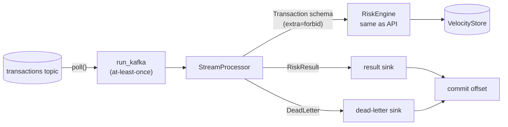

# Streaming consumer mode

`fraud_engine.stream` scores transactions from a log (Kafka today, any ordered source in
principle) instead of HTTP requests. It is a **skeleton**: the processing core,
dead-lettering, ordering policy and an at-least-once Kafka loop are implemented and tested;
producing results back to a Kafka topic, partition-aware state and metrics export are not
yet (see "Not done yet").



## Usage

```bash
# Replay a JSON-lines file (one PaySim-shaped transaction per line, labels removed)
python -m fraud_engine.stream --input txns.jsonl --output results.jsonl --dead-letter dlq.jsonl

# stdin -> stdout
cat txns.jsonl | python -m fraud_engine.stream --input -

# Kafka (optional client, not in the serving image): pip install confluent-kafka
python -m fraud_engine.stream --kafka-topic transactions --kafka-bootstrap broker:9092 \
    --kafka-group fraud-engine --output results.jsonl
```

Engine settings come from the usual `FRE_*` variables (`FRE_MODEL_PATH`, thresholds, velocity
window). A summary (`received`, `scored`, `dead_lettered`, `late`, decision counts) is printed
to stderr at the end.

| Flag | Meaning |
|---|---|
| `--allowed-lateness STEPS` | Dead-letter events more than `STEPS` behind the highest step seen. Unset = score them, just count them as late |
| `--no-update-state` | Score without recording into velocity state (what-if replays) |

## Guarantees

- **Same validation as the API.** Messages go through `Transaction` with `extra="forbid"`, so
  `isFraud` / `isFlaggedFraud`, negative or non-finite amounts and unknown fields are
  rejected before anything is scored or recorded.
- **Same scoring path.** The processor calls `RiskEngine.score()`; a test asserts the stream
  produces results identical to calling the engine directly (online/offline parity).
- **Point-in-time state.** Velocity is read before and recorded after each event, in arrival
  order. Same-step events are not late.
- **Poison messages never stop the consumer.** Oversized (>64 KiB), non-UTF-8, invalid JSON and
  schema failures go to the dead-letter sink with a reason code; payloads are truncated to
  1 KiB in the dead letter.
- **At-least-once.** `run_kafka` commits a message's offset only after its result or dead
  letter has been handed to a sink. If the sink raises, nothing is committed and the
  message is redelivered, so sinks should be idempotent on `transaction_id`. Broker errors are
  logged and not committed.

## Ordering and leakage

Offline training replays rows sorted by `step`, so a stream only reproduces training features
if each account's events arrive in step order. Kafka orders within a partition only, so:

1. Partition the input topic by a key that keeps an account's events together (in PaySim
   both `nameOrig` and `nameDest` feed velocity; partitioning by `nameOrig` keeps sender
   velocity exact, inbound/mule velocity needs a shared store, see the Redis roadmap item).
2. Use `--allowed-lateness` to stop very late events from being scored against state that
   already contains their "future". A rejected late event is not recorded either, so it can't
   change what other events see.

Late events never see the future in their own features (the window is `(step - W, step]`),
but they would be invisible to events that already scored, which offline replay would not do.
The `late` counter makes that skew visible.

## Not done yet

- Producing results to an output topic (today: JSONL file/stdout sink).
- Consumer-group rebalancing hooks and shared velocity state across partitions.
- Exporting stream stats as Prometheus metrics.
