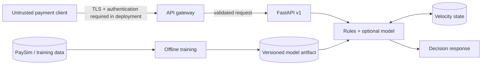

# Threat model — fraud risk scoring service

Status: baseline review, 2026-11-08. This document describes the current `v1` API; it does **not** certify production readiness.

## Assets and trust boundaries

- **Payment decision integrity:** the score, decision, reasons, and threshold configuration must not be modified by untrusted clients.
- **Account and transaction privacy:** account identifiers, balances, transaction amounts, and velocity history are sensitive.
- **Model artifact integrity:** model JSON and feature schema are executable decision inputs even if they contain no code.
- **Service availability:** API, model loading, velocity store, and downstream decision consumers must tolerate malformed and repeated events.

**Boundaries:** inbound HTTP is untrusted; a gateway is assumed but **not implemented by the application**. Velocity state and artifacts are privileged dependencies. Offline data is untrusted until validated. CI and deployment credentials are separate privileged boundaries.

## Abuse cases and controls

| Threat | Current posture | Required production control |
|---|---|---|
| Unauthenticated high-volume scoring or scraping | No built-in authentication or rate limiting | Gateway authentication, quotas, request-size limits and abuse monitoring |
| Transaction replay or duplicate events corrupt velocity counts | No durable idempotency contract | Authenticated idempotency key, bounded retention, deduplication and replay tests |
| Concurrent requests race on velocity state | In-memory state is process-local; Redis proposal still has snapshot/record race | Partition by account or implement atomic snapshot-and-record with ordered event handling |
| Post-authorisation information contaminates a decision | v1 rules/features reference post-transaction balances | Versioned pre-authorisation request contract, new feature schema and retraining; do not use v1 for payment authorisation |
| Malformed/poisoned training data | Data ingestion validation is being improved | Schema checks, finite-number checks, provenance, immutable datasets and reproducible splits |
| Compromised model artifact | Local artifact load; validation proposals exist | Digest/signature verification, trusted storage, review/approval and rollback |
| Sensitive data leaks into logs or metrics | Metrics should avoid high-cardinality account labels | Redaction tests, access controls, retention policies and no payload logging |
| Model drift and threshold instability | Baseline monitoring proposals exist | Reference-distribution checks, alert budgets, human review and safe rollback |
| Dependency or container compromise | CI and non-root Docker baseline exist | Lock dependencies, scan SBOM/images, least-privilege runtime, signed image provenance |
| Wrong environment promoted | CI/CD workflows exist; environment protection requires GitHub setup | Protected branches/environments, mandatory reviews, digest-pinned deploy and smoke tests |

## Deployment acceptance criteria

Before any production pilot: (1) eliminate post-event features, (2) implement authenticated ingress and rate limits, (3) enforce idempotency and per-account ordering, (4) verify artifact provenance, (5) perform temporal out-of-time evaluation with precision-recall and review-capacity metrics, (6) test failure modes and rollback, and (7) obtain privacy/security review.

## Verification exercises

- Submit invalid labels, non-finite monetary values, huge bodies, malformed JSON, and repeated transaction IDs; verify safe rejection and bounded resource use.
- Replay identical events across two workers and ensure velocity state is not double-counted.
- Submit transactions out of order and verify documented late-event policy.
- Simulate Redis/model unavailability and confirm fail-open/fail-closed behaviour is explicit, tested, and appropriate for the payment flow.
- Confirm no account identifiers or raw transaction payloads appear in Prometheus labels, access logs, traces, or exception messages.

This is a risk register and test plan, not evidence that the listed controls are already implemented.
